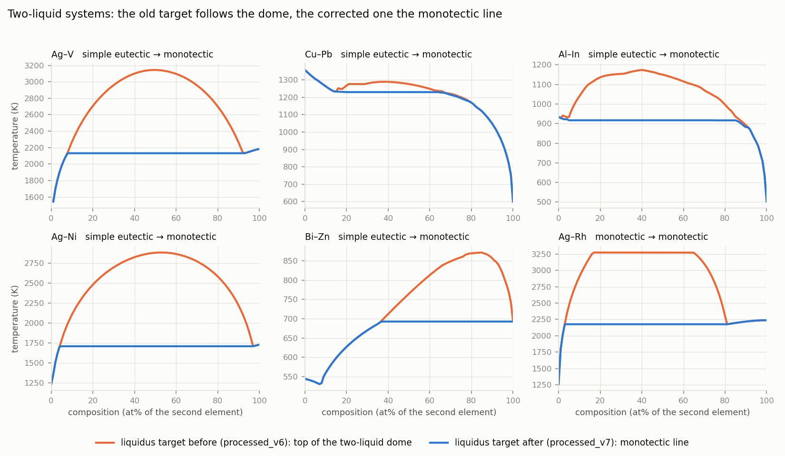
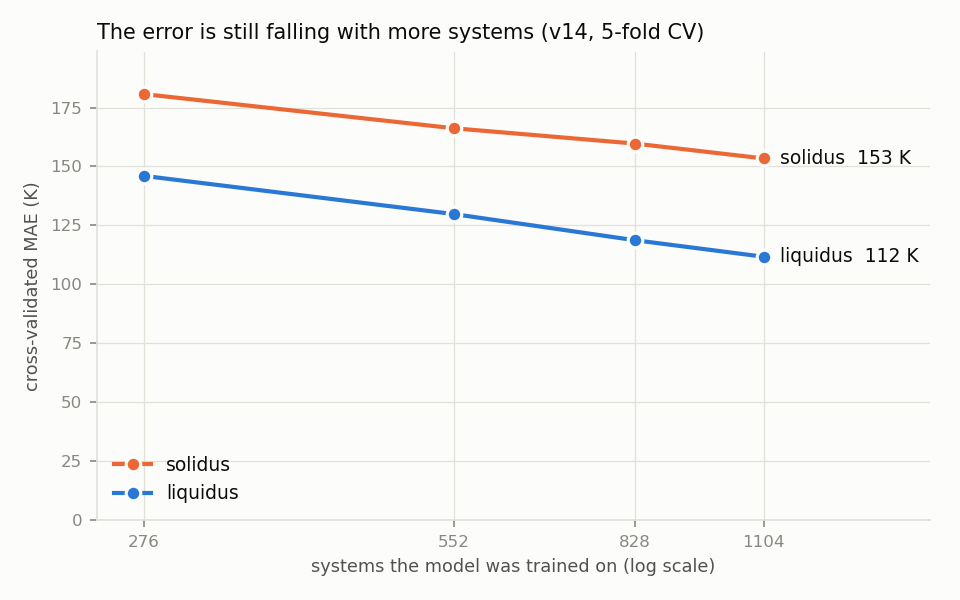
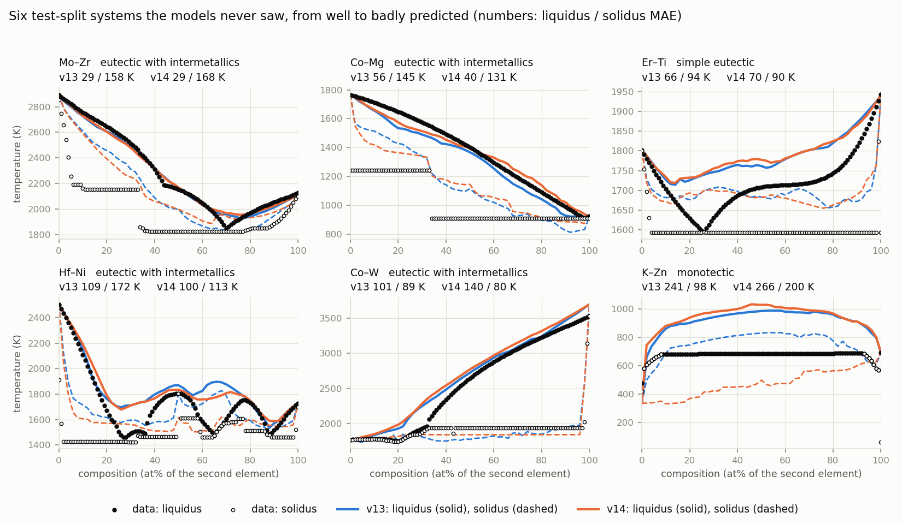

# Predicting binary phase diagrams from element properties: review and v14

Review carried out on branch `research/senior-review`, November 2026. Every number below comes from a run made during this review; the log file is named next to each table.

## Verdict

**Keep the approach, change two things in the model, and correct how the liquidus is defined in systems with two liquids.**

The current method (an ensemble of decision trees that predicts each curve as a deviation from the straight line between the two melting points) is sound. I tested a dozen alternatives, among them a thermodynamic base curve, a gradient-boosted model, and borrowing curves from chemically similar systems. Most were worse and none was better by more than 1.4 K. What limits accuracy is the data, in two ways.

First, the training target is inconsistent. In 245 of the 1,380 systems the liquid separates into two liquids, and the "liquidus" in our data there is sometimes the top of the two-liquid dome, sometimes the monotectic line, and sometimes the edge of the source chart. 101 of these systems were not even flagged as having a miscibility gap. I built a corrected dataset in which the liquidus is always the monotectic line.

Second, the model is still learning from every system it is given: halving the training data costs about 18 K, so more systems would help more than any change of algorithm.

The new model, v14, adds thermodynamic features and predicts the solidus directly. In 5-fold cross-validation it beats v13 in every fold:

| 5-fold cross-validation, all 1,380 systems | Liquidus error | Solidus error |
|---|---|---|
| v13, original targets | 116.7 K | 167.7 K |
| v14, original targets | 112.0 K | 153.4 K |
| v13 settings, corrected two-liquid targets | 102.4 K | 157.6 K |
| v14, corrected two-liquid targets | 98.9 K | 137.1 K |

"Error" is the mean absolute error over all composition points that have data. On the held-out test split, v14 lowers the liquidus error from 125.7 K to 112.9 K on the original targets; the solidus error is unchanged there (185.0 K to 184.2 K), which section 4 explains. The diagram-type, eutectic and miscibility-gap models are not worse in cross-validation, and the gap and type models are better (section 4.4).

Four decisions are yours: whether to merge the branch, whether the corrected dataset becomes the standard, whether the monotectic-line definition is the one you want (section 6), and whether inputs derived from known compounds are within the scope of the project (section 5).

## 1. What limits accuracy now

### 1.1 The liquidus is defined inconsistently in two-liquid systems

Each raw MPDS file carries the name and position of every region of the chart, including "L₁ + L₂" for the region where two liquids coexist. The preprocessing never read these labels. It took the liquidus to be the lower boundary of the single-phase liquid region, and it flagged a miscibility gap only when the liquid was drawn as two separate regions. The consequences:

- When one liquid region wraps over the two-liquid dome (Ag–V, Cu–Pb, Ag–Ni, Al–In and about a hundred others), the "liquidus" is the top of the dome, in Ag–Co 1,700 K above the temperature at which the last solid disappears, and the system is labelled "simple eutectic" or "eutectic with intermetallics".
- When the liquid is drawn as two regions, the "liquidus" between them is the monotectic line in some sources and the upper edge of the chart in others.

Reading the labels, 245 systems have two liquids according to most of their sources; the old flag marked 144. These 245 systems are 18 % of the data and carry 32 % of v13's cross-validated liquidus error (230 K against 95 K for the other systems; `results/v14/two_liquid_checks.txt`). The model cannot know which of the three drawings a given system will have, so it averages them. Figure 1 shows six examples.



*Figure 1. The liquidus target before and after the correction for six two-liquid systems.*

### 1.2 The model is limited by the number of systems

Training v14 on a quarter, a half, three quarters and all of the training systems gives liquidus errors of 146, 130, 119 and 112 K (Figure 2; `results/v14/explore_v6.txt`). Each doubling removes 16 to 18 K and the curve has not flattened. The dataset has 1,380 of the 2,211 possible pairs of its 67 elements, and the raw MPDS download contains 291 further systems that the preprocessing filters rejected.



*Figure 2. Cross-validated error of v14 against the number of training systems.*

### 1.3 A third of the error is one number per system

If the predicted liquidus of each system were shifted up or down by its own average error, the error would fall from 112 K to 75 K. In other words, a third of the error is the overall height of the curve above or below the melting-point line, and two thirds is its shape. The height reflects how strongly the two elements bind: a very stable compound melts far above both elements, and the model underestimates the highest ones (AlP, AlAs, GaAs, ZnTe).

I tested two ways to supply this information and neither worked well. A separate model trained only on the height was no more accurate than the height the curve model already implies. Computed formation energies of the known compounds, from the Materials Project database, lowered the liquidus error by 1.4 K (section 5).

### 1.4 Knowing the diagram type would not improve the curves

I gave the curve model the true diagram type, the true miscibility-gap flag and the true eutectic point as extra inputs. This is an upper bound on what perfect classifiers could contribute. The liquidus error did not improve (112 to 113 K) and the solidus improved by 4 K. So building the curves from predicted landmarks, one of the ideas on our list, cannot pay off with this kind of model: the curve model already extracts from the element properties what the labels would tell it.

### 1.5 What does not limit accuracy

- **The model family and its settings.** No setting of the trees beats the current one by more than 1 K (section 5).
- **Disagreement between sources.** Where several sources describe a system they agree to within a few kelvin (median spread 2.6 K, measured earlier in `results/v11/noise_floor.txt`; not re-measured in this review).
- **The preprocessing code as such.** Re-running it on the raw files reproduces `processed_v6` exactly, file for file.

### 1.6 What the worst remaining systems are

With v14 on the corrected targets, the worst 10 % of systems still carry 32 % of the liquidus error, and the typical system is predicted to 74 K while the mean per system is 104 K (out-of-fold over all 1,380 systems; `results/v14/extra_checks.txt`, picture in `results/v14/worst_30_two_liquid.png`). The worst thirty fall into four groups: compounds of P, As, S, Se and Te that melt far above both elements; carbon systems, where the "melting point" of carbon is a sublimation point and the diagrams are partial; diagrams drawn schematically as a straight line between the melting points (In–Nb, Eu–Ta, Mo–Y, Cr–Eu), which are placeholders rather than measurements; and strongly immiscible pairs, where the right answer is a flat line just below the higher melting point and the model predicts a sagging curve.

## 2. The options I considered

| Option | Expected gain | Evidence | Cost | Decision |
|---|---|---|---|---|
| Keep the tree curve model, add thermodynamic features | 3–8 K | Features were only 50/50-mixture statistics; no heat of fusion | Low | **Done**: −4.7 K liquidus, every fold |
| Predict the solidus directly instead of as a gap below the predicted liquidus | 5–15 K on the solidus | Solidus error tracked liquidus error | Low | **Done**: −12 to −14 K solidus, every fold |
| Train on the validation systems as well | 2–3 K | Tree models never use the validation split | None | **Done**: −2.4 K in cross-validation |
| Correct the two-liquid targets | 10–15 K | 32 % of the error in 18 % of systems | Medium | **Done**: −14 K liquidus for the same model |
| Thermodynamic (regular-solution) curve as the base instead of the straight line | Unknown | On our list of untried ideas | Low | Tested, **worse**; kept as features only |
| One model row per composition point, with composition-specific features (gradient boosting) | Unknown | Different error structure from the forests | Medium | Tested, **worse** |
| Borrow curves from systems sharing an element, weighted by measured chemical similarity | Unknown | 62 % of all element pairs are in the data | Medium | Tested, **worse** |
| Build curves from predicted landmarks (eutectic point, gap) | ≤ 4 K solidus | Upper-bound test, section 1.4 | High | **Rejected** on the upper bound |
| CALPHAD-style prediction of Gibbs-energy parameters | Unknown | More than 800 of the 1,380 systems contain intermetallic compounds, whose existence and stability such a model would have to predict first | Very high | **Not pursued** (see below) |
| Computed compound formation energies as features | 5–30 K hoped | Section 1.3 | Medium | Tested: −1.4 K; **not adopted** |
| More systems | ~17 K per doubling | Section 1.2 | Medium to high | **Recommended next** |

On the thermodynamic route: predicting the interaction parameters of the liquid would give physically shaped curves for systems without compounds, but most of our systems have compounds, and the liquidus over a compound is set by that compound's stability, which no element-property model predicts reliably. The published work closest to ours made the same choice: Deffrennes and co-workers predict the liquidus directly with machine learning from element properties and Miedema quantities, and treat the miscibility gap with separate models, rather than predicting Gibbs energies ([Deffrennes et al., Materials & Design 2023](https://doi.org/10.1016/j.matdes.2023.112111)). The useful part of the thermodynamic idea, the regular-solution liquidus, is now in the model as input features, where it accounts for most of the feature gain.

For context, a study of 85,523 alloy compositions from 429 binary systems reports that machine learning did little better than interpolating linearly between the two melting points, and that the features matter more than the algorithm ([He et al., "Can machine learning predict the liquidus temperature of binary alloys?"](https://jamming.research.yale.edu/files/papers/liquidus.pdf); I could not open the full text and rely on a summary of it, so check the paper before citing these two statements). On our data linear interpolation gives 256 K and v14 gives 112 K, and our experience with features and algorithms matches theirs.

## 3. What I built

**The v14 model.** Three changes to v13, each behind an option of the training script:

- *Extended features* (`mpds_models/element_features.py`, 147 new columns added to the 207). Per element: heat and entropy of fusion, heat of vaporisation, elastic moduli, cohesive energy, Miedema's parameters, ground-state crystal structure. Per pair: Miedema enthalpies at five compositions instead of one, Miedema's tabulated enthalpy of mixing of the liquid, and the liquidus of a regular solution with no solid solubility (the Schröder–van Laar equation), described by its eutectic point and its distance from the melting-point line at seven compositions. All tables ship with the matminer package (BSD-style licence); sources are listed in the module. Nothing is fitted to the phase diagrams.
- *Direct solidus.* v13 predicted the gap between liquidus and solidus, so every error of the predicted liquidus was passed on to the solidus. v14 predicts the solidus as its own deviation from the melting-point line and caps it at the liquidus.
- *Training on the validation systems too.* Only the abandoned neural network used the validation split. The tree models never looked at it, so a ninth of the training data was being left out.

**The corrected dataset `processed_v7`** (`build_two_liquid_dataset.py`). One rule: a region contains liquid if it is L, L + solid, or L₁ + L₂. From that rule:

- the liquidus is the lowest temperature with no solid. Where a source's liquidus rises over a labelled two-liquid region, the dome is cut down to the monotectic line;
- the solidus is the lowest temperature with any liquid, so regions under a two-liquid region now count as liquid plus solid;
- the miscibility-gap flag is true if the source has two liquid regions or an "L₁ + L₂" label, and the diagram type follows from it by the unchanged rules: 101 systems move to "monotectic" (58 from "simple eutectic", 37 from "eutectic with intermetallics", 6 from "complex");
- the dome that was cut off is saved as a new target, the binodal, for 235 systems. It is not modelled yet and I have not validated it.

The liquidus changed in 223 systems (13,467 points, all lowered, none raised). The same systems sit in the same rows and folds as before, and nothing in `processed_v6` or the preprocessing package was modified. As a spot check, for 16 well-known monotectic systems the corrected liquidus lies a median of 4 K, and at most 15 K, from the monotectic temperatures I remember from the handbooks (`results/v14/two_liquid_checks.txt`). Those reference values are from memory and must be checked against a handbook before anyone cites them. For three more systems (Ag–Fe, Ag–Cr, Bi–Fe) I did not trust my memory and left them out; they should be checked by hand.

**Tools.** `cross_validate.py` compares named model versions over the same five folds, for the curves and for the scalar models. `explore_curve_variants.py` re-runs every experiment of sections 1 and 5.

## 4. Results against v13

### 4.1 Cross-validation on the original targets

Five folds over all 1,380 systems; every model trains on all systems of the training folds. Log: `results/v14/cv_v6_curves.txt`. Entries are liquidus / solidus error in K.

| Systems | v13 | v14 | Folds won by v14 |
|---|---|---|---|
| All (1,380) | 116.7 / 167.7 | 112.0 / 153.4 | 5 of 5 / 5 of 5 |
| Clean (883) | 95 / 150 | 93 / 139 | |
| Incomplete diagram (132) | 224 / 321 | 215 / 281 | |
| Volatile element (356) | 136 / 178 | 133 / 157 | |
| Monotectic (144) | 232 / 284 | 205 / 276 | |

"Clean" means a complete diagram with no element boiling below 1,300 K and no miscibility gap; the other groups overlap. The v13 figure recorded earlier, 119.1 K, was obtained with a tenth of each training fold held back; I reproduced it (119.1 / 170.1 K) before changing anything.

Taken one at a time: the extended features give 116.7 → 112.0 K on the liquidus, and the direct solidus gives 167.7 → 154.1 K on the solidus with the old features. Both win all five folds.

### 4.2 Cross-validation on the corrected two-liquid targets

Same folds, same systems, same groups as above. Log: `results/v14/cv_v7_curves.txt`.

| Systems | v13 settings | v14 | Folds won by v14 |
|---|---|---|---|
| All (1,380) | 102.4 / 157.6 | 98.9 / 137.1 | 5 of 5 / 5 of 5 |
| Clean (883) | 85 / 137 | 84 / 125 | |
| Incomplete diagram (132) | 228 / 355 | 210 / 272 | |
| Volatile element (356) | 126 / 169 | 122 / 142 | |
| Monotectic by the old flag (144) | 158 / 225 | 136 / 184 | |

These errors are measured against a different target from those in 4.1, so the drop from 116.7 to 102.4 K is partly the model doing better and partly the target no longer containing domes that no model could place. Both are improvements for our purpose, but the two tables should not be mixed.

### 4.3 The test split

138 systems that no model saw, scored as before with `predict.py --mask-clipped --fix-end-points`. Logs: `results/v14/predict_*.txt`.

| Original targets | v13 | v14 |
|---|---|---|
| All (138) | 125.7 / 185.0 | 112.9 / 184.2 |
| Clean (91) | 114 / 175 | 99 / 173 |
| Incomplete diagram (17) | 164 / 276 | 166 / 290 |
| Volatile element (35) | 145 / 175 | 139 / 163 |
| Monotectic (14) | 250 / 386 | 253 / 415 |

| Corrected targets | v13 settings | v14 |
|---|---|---|
| All (138) | 110.3 / 176.7 | 103.5 / 161.3 |
| Clean (85) | 90 / 161 | 86 / 151 |
| Incomplete diagram (17) | 176 / 348 | 179 / 295 |
| Volatile element (35) | 138 / 216 | 133 / 186 |
| Monotectic (24) | 192 / 230 | 166 / 194 |

Three things in these tables need saying plainly.

- **The liquidus gain on the test split has two halves.** Training v13 on the validation systems as well gives 119.3 K; v14 without them gives 118.5 K; both together give 112.9 K. About half of the 12.8 K comes from the extra 138 training systems and half from the new features.
- **The solidus did not improve on the original test split** (185.0 → 184.2 K), although it improved by 14 K in cross-validation. I checked whether cross-validation was misleading. On these same 138 systems, predicted out-of-fold, the direct solidus is 6 K better rather than 12 K, because three of them (In–Nb, Cr–Pb, Cr–Eu) have solidus errors of about 800 to 1,200 K that each grew by about 300 K; In–Nb and Cr–Eu are schematic straight-line diagrams. Over 2,000 random subsets of 138 systems, the direct solidus was better in 99 % of them, by 12 K on average (`results/v14/extra_checks.txt`). So the gain is real and this split is an unlucky draw. This is the reason the project decides by cross-validation.
- **The incomplete and monotectic groups did not improve on the original test split.** They have 17 and 14 systems. In cross-validation, with 132 and 144 systems, both improve.

Figure 3 shows six test systems, from well to badly predicted.



*Figure 3. Data, v13 and v14 for six test-split systems (original targets).*

### 4.4 Diagram type, eutectic and miscibility gap

**Cross-validation.** The three scalar models with the original and with the extended features, same five folds (`results/v14/cv_v6_scalars.txt`). The diagram-type row is the stand-alone classifier; the stacked classifier that v13 and v14 use for their final answer takes too long to cross-validate and is covered by the test split below.

| Original targets | v13 features | v14 features | Folds better |
|---|---|---|---|
| Miscibility gap, F1 | 0.562 | 0.610 | 5 of 5 |
| Miscibility gap, ROC-AUC | 0.907 | 0.928 | 5 of 5 |
| Diagram type, accuracy | 74.7 % | 76.1 % | 4 of 5 |
| Diagram type, macro-F1 | 0.584 | 0.598 | 3 of 5 |
| Eutectic exists, F1 | 0.900 | 0.900 | 2 of 5 (tie) |
| Eutectic exists, ROC-AUC | 0.859 | 0.866 | 3 of 5 |
| Eutectic composition error | 19.8 at% | 18.9 at% | 5 of 5 |
| Eutectic temperature error | 164.8 K | 164.8 K | identical |

The two eutectic position errors are over every system that has a eutectic. The eutectic temperature is identical because v14 keeps that regressor on the original features (section 5). One sub-score went down: the F1 of the "isomorphous" class, 0.557 → 0.515, better in only one fold; that class has 81 systems.

On the corrected targets the features make little difference to the classifiers (gap F1 0.762 → 0.767, type accuracy 77.1 → 78.0 %, each better in 2 of 5 folds; `results/v14/cv_v7_scalars.txt`). There the improvement comes from the labels themselves: with the same features the gap F1 rises from 0.56 to 0.76 and the type accuracy from 74.7 to 77.1 %.

**Test split**, full pipeline with the stacked type classifier (`results/v14/predict_*.txt`):

| | v13 | v14 | v13 settings, corrected targets | v14, corrected targets |
|---|---|---|---|---|
| Diagram type, accuracy | 74.6 % | 75.4 % | 74.6 % | 76.8 % |
| Diagram type, macro-F1 | 0.616 | 0.646 | 0.636 | 0.663 |
| Eutectic exists, F1 | 0.894 | 0.893 | 0.894 | 0.893 |
| Eutectic composition error | 20.4 at% | 17.6 at% | 20.4 at% | 17.6 at% |
| Eutectic temperature error | 189 K | 179 K | 189 K | 179 K |
| Miscibility gap, F1 | 0.632 | 0.605 | 0.769 | 0.885 |
| Gaps: true / predicted | 14 / 24 | 14 / 29 | 24 / 28 | 24 / 28 |

The one number that is lower for v14 is the miscibility-gap F1 on the original test split: it finds 13 of the 14 gaps instead of 12, but predicts 29 instead of 24. With 14 true cases this is within chance, and cross-validation over 144 cases shows a gain in every fold. On the corrected targets, where the test split has 24 true cases, the F1 goes from 0.77 to 0.89.

A warning about all scalar numbers on the test split: they depend on whether XGBoost ran on the graphics card or the processor. The machine's graphics card became visible after a restart during this review, and the identical v14 command then gave 79.0 % type accuracy instead of 75.4 %. Every model in this report was trained on the processor, as v13 was, and the training script now enforces that. A difference of a few points on 138 systems should not be read as a result.

## 5. What did not work

All in 5-fold cross-validation against v14 on the original targets; log `results/v14/explore_v6.txt`. "Folds won" counts the folds in which the variant beat v14.

The reference in this log is 111.7 / 153.4 K; the experiment script fits the curves with its own copy of the code and comes out 0.3 K below the package's 112.0 K.

| Variant | Liquidus / solidus (K) | Folds won | Outcome |
|---|---|---|---|
| Regular-solution liquidus as the base curve instead of the straight line | 133.7 / – | 0 of 5 | Worse. On its own this curve has an error of 758 K, because a strongly negative mixing enthalpy predicts a deep eutectic where the real system forms a compound. As input features the same curve helps. |
| Ideal-solution liquidus as the base curve | 117.7 / – | 0 of 5 | Worse |
| Predicting the deviation relative to the mean melting point | 113.3 / – | 0 of 5 | Worse |
| Curves borrowed from systems that share one element, weighted by how alike the other two elements behave | 131.8 / – | 0 of 5 | Worse; averaging it with v14 also loses |
| Gradient boosting on one row per composition point, with composition-specific features | 120.9 / – | 0 of 5 | Worse on its own |
| The same, blended 30 : 70 with v14 | 111.0 / – | 4 of 5 | Passes the rule by 0.7 K. Not adopted: the weight was picked on these folds, and it adds a second model for under 1 K. |
| Miscibility-gap probability from a classifier as an extra input | 111.9 / 153.9 | 3 / 2 | No gain |
| A separate model for the height of the curve, used to shift it | 111.8 / – | 3 of 5 | No gain: 95.9 K error on the height, against 93.8 K from the curve model itself |
| Computed formation energies of known compounds (Materials Project) | 110.3 / 151.6 | 4 / 5 | Passes the rule by 1.4 K (1.7 K on the corrected targets, 5 of 5). Not adopted, see below. |
| Knots every 1 at% instead of 2 | 111.5 / 152.5 | 4 / 5 | Passes the rule by 0.2 / 0.9 K. Not adopted: doubles the 480 MB model file. |
| 600 trees instead of 300 | 111.6 / 152.9 | 2 / 5 | No gain on the liquidus |
| Other tree settings (leaf size 1 or 3, half or a third of the features per split) | 111.5 to 113.1 | at most 4 / 4 | Within 0.5 K, or worse |
| Mean over the trees instead of the median | 115.3 / 158.8 | 1 / 0 | Worse; confirms the v13 choice |
| Eutectic point read off the predicted liquidus instead of the separate eutectic model | – | – | Worse: 195 K and 24.5 at% against 165 K and 19 at% (`results/v14/extra_checks.txt`) |

Three of these deserve a comment.

**Formation energies of known compounds.** This is the only new information source that passed the rule, and I left it out on purpose. Most Materials Project entries are calculations of compounds that are known from experiment, so the features tell the model which compounds have been observed in a system. That is knowledge of the phase diagram itself, and for a system nobody has studied the features would be nearly empty. Whether such inputs are within the scope of "from properties of the two elements" is a scientific choice, and it is yours. The code is in `mpds_models/compound_features.py`.

**The eutectic model with the extended features.** The extended features improve the eutectic composition (19.8 → 18.9 at%, every fold) but made the eutectic temperature slightly worse: 164.8 → 166.2 K over all systems with a eutectic, worse in 3 of 5 folds, and 161.0 → 163.4 K, worse in 4 of 5, by the score `predict.py` uses (`results/v14/cv_v6_scalars_all_features.txt`). In v14 the temperature regressor therefore keeps the original features.

**The eutectic target itself.** In 38 % of the systems that have a eutectic, the eutectic temperature in our data lies more than 50 K away from our own liquidus at the eutectic composition, and in 15 % the eutectic composition is within 2 at% of a pure element (`results/v14/eutectic_target_check.txt`). The target is the lowest point of the MPDS list of invariant points, averaged over sources, and the sources do not always list the same point. The eutectic errors we report (about 19 at% and 165 K) therefore measure this inconsistency as much as the model.

## 6. Are these the right metrics?

Mostly yes, with three changes I recommend.

1. **Score against a physically consistent liquidus.** The original target mixes the liquidus with the liquid–liquid boundary. A model that correctly predicted "last solid disappears at 1,230 K" for Cu–Pb was being charged up to 130 K for it. The corrected dataset fixes this, and the dome becomes its own target with its own score. This needs your agreement on the definition: I took the liquidus to be the temperature above which no solid remains, so that under a two-liquid dome it is the monotectic line.
2. **Report the typical system next to the average.** The point-weighted mean is dominated by a few systems: the worst tenth carries a third of the error, and several of those are schematic or pressure-dependent diagrams. On the test split with corrected targets the mean error per system is 108 K but the median is 72 K, and for clean systems 67 K. The median describes what a user should expect for an ordinary alloy system; the mean describes the risk of a bad miss. Both belong in the headline.
3. **Score the features a metallurgist reads off a diagram.** The mean error over composition rewards smooth curves and is nearly blind to whether a eutectic or a compound peak is in the right place. I suggest adding the error of the lowest liquidus temperature and its composition, and the error of the highest liquidus temperature above the higher melting point. I did not implement these.

## 7. Next steps, ranked by expected gain

1. **Adopt the corrected dataset and check it by hand.** The gain is already measured (section 4). What remains is your confirmation of the definition, a manual check of a sample of the 223 changed systems (listed in `/home/alibi/lab/processed_v7/changes_vs_reference.csv`), and the three systems named in section 3.
2. **More systems.** Expected 3 to 5 K from the 291 systems the filters rejected, if most can be recovered, and about 17 K for every doubling beyond that. 88 of the 291 have an entry that passes the quality filter and fail only because its temperature unit could not be determined; the other 203 have only partial-range entries or no usable liquidus (`results/v14/extra_checks.txt`). Partial diagrams are worth having: an earlier experiment found that leaving incomplete diagrams out makes every fold worse (`results/v12`, not re-run here). The liquidus curves of 466 assessed systems published with Deffrennes et al. (CC BY 4.0) are a second source for pairs MPDS lacks.
3. **Flag or remove schematic diagrams and treat carbon separately.** A straight line between the melting points over the whole range, in a system whose neighbours all show gaps or compounds, is a placeholder. These cases cost little in the mean but dominate the worst-case list and the test-split solidus.
4. **Model the two-liquid dome.** The data now exist for 235 systems. With the gap flag corrected, the gap classifier is much better (section 4.4), so "is there a dome, and how high" becomes a tractable separate question, as in Deffrennes et al.
5. **An error bar on each prediction.** Errors are concentrated in a few systems, and systems far from the training data are predicted about 2.5 times worse than close ones (181 K against 71 K on the test split). The spread between the trees is already computed; calibrating it would let the model say which of its diagrams to trust. Not tested.
6. **Compound stability from a database that enumerates hypothetical structures** (OQMD prototypes, AFLOW). Low priority: the Materials Project version gave 1.4 K.

I would not spend more time on tree settings, on other model families, or on building curves from predicted landmarks.

## 8. Reproducing this, and what is where

```bash
conda activate ml
D=/home/alibi/lab/processed_v6

# v14 (original targets)
python -m mpds_models.train_all $D /home/alibi/lab/models_v14 --curve-model extra_trees \
    --curve-aggregate median --swap-augment --mask-clipped \
    --features extended --curve-solidus direct --train-with-val
python predict.py $D /home/alibi/lab/models_v14 --report results/v14/report_v14.json \
    --mask-clipped --fix-end-points --no-uncertainty

# cross-validation
python cross_validate.py $D --out results/v14/cv_v6 --configs v13 v13+direct v14-features v14

# corrected dataset
python build_two_liquid_dataset.py /home/alibi/lab/mpds_data /home/alibi/lab/processed_v7 \
    --reference $D --preprocess-dir /home/alibi/lab
```

`results/v14/train_and_score.sh` trains and scores all six models of section 4.3, on the processor (`MPDS_DEVICE=cpu`). With no new options the training script reproduces the saved v13 report exactly; I checked this with the final code (`results/v14/report_v13_rerun.json` equals `results/v13/report_v13.json`).

Files created outside the repository: the dataset `/home/alibi/lab/processed_v7`, the models `/home/alibi/lab/models_v14` and `/home/alibi/lab/models_v14_two_liquid`, and the Materials Project file `/home/alibi/lab/external/mp_nostruct_20181018.json.gz` (3 MB, used only by the experiment in section 5). Nothing outside the repository was modified or deleted.

Nothing has been pushed or merged. The work is on the local branch `research/senior-review`.
